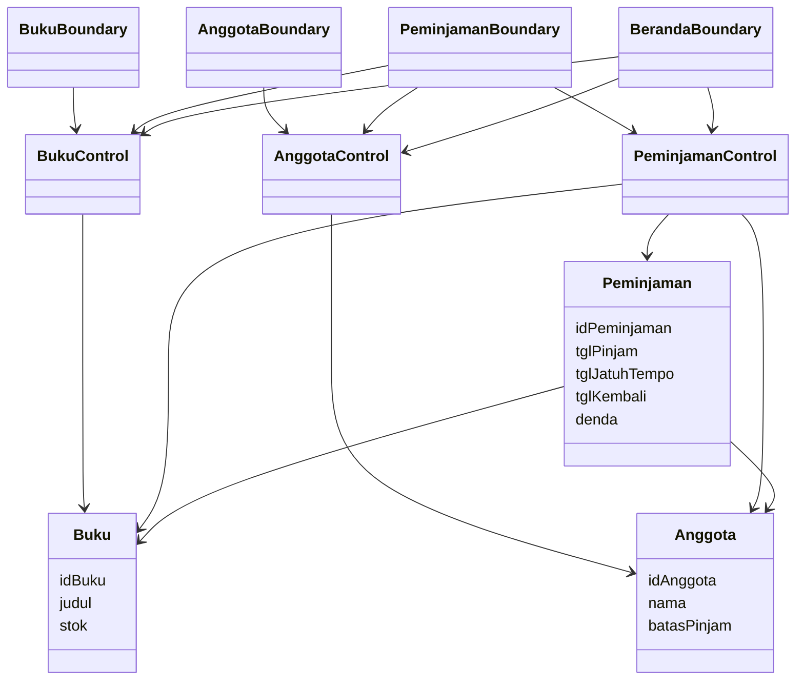
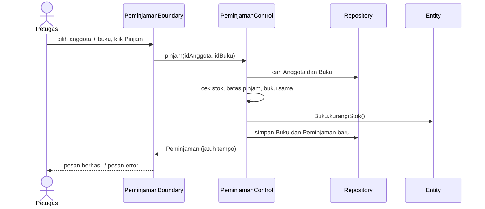
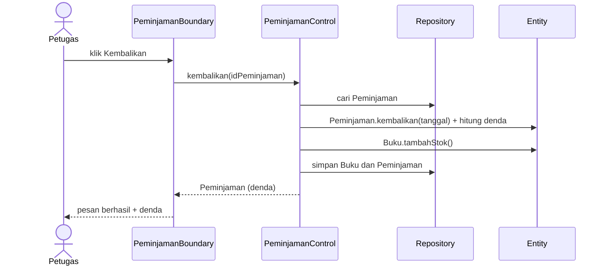

# Sistem Informasi Perpustakaan (Spring Boot, pola BCE)

Aplikasi web perpustakaan: kelola buku, kelola anggota, pinjam buku, kembalikan buku, hitung denda.
Teknologi: Java 25 (LTS), Spring Boot 3.5.16, Spring MVC, Thymeleaf, Spring Data JPA, H2 (in-memory).

## Pemetaan BCE

| Lapisan  | Package / lokasi                              | Isi                                            |
|----------|-----------------------------------------------|------------------------------------------------|
| Boundary | `boundary/`, `resources/templates/`, `static/`| `BerandaBoundary`, `BukuBoundary`, `AnggotaBoundary`, `PeminjamanBoundary` + halaman HTML |
| Control  | `control/`                                    | `BukuControl`, `AnggotaControl`, `PeminjamanControl` (aturan bisnis) |
| Entity   | `entity/`, `repository/`                      | `Buku`, `Anggota`, `Peminjaman` + repository   |

Aturan: Boundary hanya memanggil Control. Control memakai Repository dan Entity. Boundary tidak menyentuh Repository.

## Use case

1. Kelola Buku (lihat, cari, tambah, ubah, hapus)
2. Kelola Anggota (lihat, tambah, ubah, hapus)
3. Pinjam Buku
4. Kembalikan Buku (hitung denda)
5. Lihat Ringkasan (beranda)

## Aturan bisnis

- Lama pinjam 7 hari. Denda Rp 1.000 per hari terlambat.
- Pinjam ditolak jika: stok buku 0, anggota sudah mencapai `batasPinjam`, atau anggota masih memegang buku yang sama.
- Pinjam: stok buku berkurang 1. Kembali: stok bertambah 1.
- Buku atau anggota yang punya riwayat peminjaman tidak bisa dihapus.

## Diagram kelas BCE



## Sequence diagram: Pinjam Buku



## Sequence diagram: Kembalikan Buku



## Menjalankan di localhost (VS Code)

Prasyarat: JDK 25 atau lebih baru, Maven (atau Extension Pack for Java di VS Code).

```bash
mvn spring-boot:run
```

Buka http://localhost:8080 (halaman: `/`, `/buku`, `/anggota`, `/peminjaman`).

Data awal ada di `src/main/resources/data.sql`. Data kembali ke kondisi awal setiap aplikasi dijalankan ulang.

Konsol H2 (opsional): jalankan dengan variabel `H2_CONSOLE=true`, buka `/h2-console`,
JDBC URL `jdbc:h2:mem:perpustakaan`, user `sa`, password kosong.

## Menjalankan test

```bash
mvn test
```

## Deploy ke Railway

1. Push kode ke GitHub (lihat bawah).
2. Di Railway: New Project, Deploy from GitHub repo, pilih repo ini. Railway menemukan `Dockerfile` dan memakainya.
3. Buka service, tab Settings, Networking, klik Generate Domain.
4. Buka URL yang muncul. Aplikasi membaca port dari variabel `PORT` otomatis (`server.port=${PORT:8080}`).

Catatan: database H2 in-memory, jadi data kembali ke `data.sql` setiap redeploy atau restart.

## Push ke GitHub

```bash
git add .
git commit -m "Refactor perpustakaan BCE: tambah peminjaman, pengembalian, denda"
git push origin main
```
